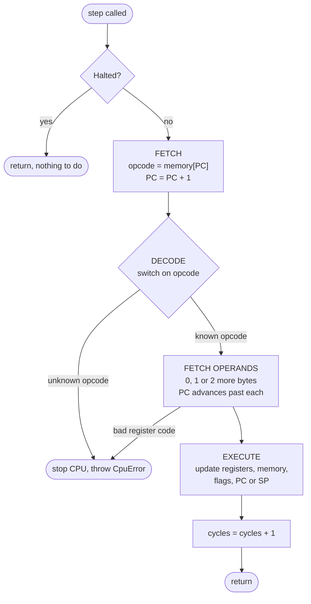

# KM-8: an 8-bit CPU emulator in C++17

KM-8 is a small, made-up 8-bit CPU. I designed it from scratch and wrote an emulator for it in C++17. The project includes:

- a **CPU emulator** that runs KM-8 machine code one fetch-decode-execute cycle at a time,
- a **two-pass assembler** that turns KM-8 assembly text into machine code,
- a **command-line runner**, `km8`, with an optional instruction-by-instruction trace,
- **five example programs** and **100 unit tests** (Catch2).

The design is deliberately small enough to understand completely. It has 4 registers, 2 flags, 256 bytes of memory and 22 instructions. The full design is in [docs/SPEC.md](docs/SPEC.md).

## The fetch-decode-execute cycle

Every call to `Cpu::step()` runs one instruction through this cycle:



`Cpu::run(maxCycles)` calls `step()` repeatedly until the program executes `HALT` or `maxCycles` instructions have run. The limit stops an infinite loop from hanging the emulator.

## The machine

| Part      | Size       | Notes                                                            |
|-----------|------------|------------------------------------------------------------------|
| A, B, C, D | 8 bits each | general registers, codes 0–3 in machine code                  |
| PC        | 8 bits     | program counter, starts at 0                                     |
| SP        | 8 bits     | stack pointer, starts at 0; the first PUSH writes to address 255 |
| Z flag    | 1 bit      | set when a result is 0                                           |
| C flag    | 1 bit      | carry (ADD) or borrow (SUB, CMP)                                 |
| Memory    | 256 bytes  | programs load at address 0                                       |

All arithmetic wraps around: 255 + 1 = 0, and 0 − 1 = 255.

## Instruction set

Each instruction is one opcode byte followed by 0, 1 or 2 operand bytes.

| Opcode | Instruction    | Meaning                                    | Flags                        |
|--------|----------------|--------------------------------------------|------------------------------|
| 0x00   | `HALT`         | stop                                       | –                            |
| 0x01   | `NOP`          | do nothing                                 | –                            |
| 0x02   | `LDI r, value` | r = value                                  | –                            |
| 0x03   | `LOAD r, addr` | r = memory[addr]                           | –                            |
| 0x04   | `STORE r, addr`| memory[addr] = r                           | –                            |
| 0x05   | `MOV r1, r2`   | r1 = r2                                    | –                            |
| 0x10   | `ADD r1, r2`   | r1 = r1 + r2                               | Z if result 0; C if > 255    |
| 0x11   | `SUB r1, r2`   | r1 = r1 − r2                               | Z if result 0; C if r2 > r1  |
| 0x12   | `INC r`        | r = r + 1                                  | Z only                       |
| 0x13   | `DEC r`        | r = r − 1                                  | Z only                       |
| 0x20   | `AND r1, r2`   | r1 = r1 AND r2                             | Z; C cleared                 |
| 0x21   | `OR r1, r2`    | r1 = r1 OR r2                              | Z; C cleared                 |
| 0x22   | `XOR r1, r2`   | r1 = r1 XOR r2                             | Z; C cleared                 |
| 0x30   | `CMP r1, r2`   | like SUB, but only sets flags              | as SUB; r1 unchanged         |
| 0x40   | `JMP addr`     | PC = addr                                  | –                            |
| 0x41   | `JZ addr`      | jump if Z set                              | –                            |
| 0x42   | `JNZ addr`     | jump if Z clear                            | –                            |
| 0x43   | `JC addr`      | jump if C set                              | –                            |
| 0x50   | `PUSH r`       | SP = SP − 1; memory[SP] = r                | –                            |
| 0x51   | `POP r`        | r = memory[SP]; SP = SP + 1                | –                            |
| 0x52   | `CALL addr`    | push address of next instruction; PC = addr | –                           |
| 0x53   | `RET`          | pop an address into PC                     | –                            |

An unknown opcode or a register code above 3 stops the CPU with a clear error, for example `unknown opcode 0xFF at address 0x80`.

## Assembly language

```asm
; countdown.asm - count down from 10 to 0 using a loop.
        LDI A, 10       ; start the counter at 10
loop:   DEC A           ; count down by one; Z is set when A becomes 0
        JNZ loop        ; not zero yet? go round again
        HALT
```

- One instruction per line. Operands are separated by commas.
- Registers are `A`–`D`. Numbers are decimal (`10`) or hex (`0x0A`), from 0 to 255.
- A label (`loop:`) names the address of the next instruction and can be used anywhere an address is expected.
- `;` starts a comment.
- Instruction and register names are not case-sensitive. Labels are.
- Errors give the line number, for example `line 2: unknown instruction 'FOO'`.

## Building, testing and running

You need a C++17 compiler (Clang, GCC or MSVC), CMake 3.14 or newer, and an internet connection the first time you configure, because CMake downloads Catch2.

**Build:**

```bash
cmake -S . -B build
cmake --build build
```

**Run all tests:**

```bash
ctest --test-dir build --output-on-failure
```

You can also run the test program directly. It prints a one-line summary:

```bash
./build/km8_tests
```

**Run an example program:**

```bash
./build/km8 run programs/add.asm
./build/km8 run programs/countdown.asm --trace
```

### Example programs

| File | What it does | Final answer |
|------|--------------|--------------|
| [programs/add.asm](programs/add.asm) | adds 25 and 17 | A = 42 |
| [programs/countdown.asm](programs/countdown.asm) | counts down from 10 to 0 in a loop | A = 0, Z = 1 |
| [programs/multiply.asm](programs/multiply.asm) | 6 × 7 by repeated addition | A = 42 |
| [programs/sum_array.asm](programs/sum_array.asm) | adds 5 numbers stored in memory | A = 150 |
| [programs/subroutine.asm](programs/subroutine.asm) | calls a "double" subroutine twice | A = 20 |

The tests in `tests/test_programs.cpp` assemble and run each of these and check the answer.

### Example output: `countdown.asm --trace`

Each trace line shows the instruction that just ran and the registers, SP and flags **after** it.

```text
$ ./build/km8 run programs/countdown.asm --trace
cycle  addr  instruction     registers after               SP    Z C
    1  0x00  LDI A, 10       A=10   B=0    C=0    D=0      0x00  0 0
    2  0x03  DEC A           A=9    B=0    C=0    D=0      0x00  0 0
    3  0x05  JNZ 0x03        A=9    B=0    C=0    D=0      0x00  0 0
    4  0x03  DEC A           A=8    B=0    C=0    D=0      0x00  0 0
    5  0x05  JNZ 0x03        A=8    B=0    C=0    D=0      0x00  0 0
    6  0x03  DEC A           A=7    B=0    C=0    D=0      0x00  0 0
    7  0x05  JNZ 0x03        A=7    B=0    C=0    D=0      0x00  0 0
    8  0x03  DEC A           A=6    B=0    C=0    D=0      0x00  0 0
    9  0x05  JNZ 0x03        A=6    B=0    C=0    D=0      0x00  0 0
   10  0x03  DEC A           A=5    B=0    C=0    D=0      0x00  0 0
   11  0x05  JNZ 0x03        A=5    B=0    C=0    D=0      0x00  0 0
   12  0x03  DEC A           A=4    B=0    C=0    D=0      0x00  0 0
   13  0x05  JNZ 0x03        A=4    B=0    C=0    D=0      0x00  0 0
   14  0x03  DEC A           A=3    B=0    C=0    D=0      0x00  0 0
   15  0x05  JNZ 0x03        A=3    B=0    C=0    D=0      0x00  0 0
   16  0x03  DEC A           A=2    B=0    C=0    D=0      0x00  0 0
   17  0x05  JNZ 0x03        A=2    B=0    C=0    D=0      0x00  0 0
   18  0x03  DEC A           A=1    B=0    C=0    D=0      0x00  0 0
   19  0x05  JNZ 0x03        A=1    B=0    C=0    D=0      0x00  0 0
   20  0x03  DEC A           A=0    B=0    C=0    D=0      0x00  1 0
   21  0x05  JNZ 0x03        A=0    B=0    C=0    D=0      0x00  1 0
   22  0x07  HALT            A=0    B=0    C=0    D=0      0x00  1 0

Program halted.

Registers:  A=0    B=0    C=0    D=0
PC:         0x08
SP:         0x00
Flags:      Z=1  C=0
Cycles:     22
```

At cycle 20, `DEC A` takes A to 0 and sets Z. That means `JNZ` at cycle 21 falls through to `HALT`.

## Project layout

```text
include/km8/      public headers
  cpu.hpp           the Cpu class, CpuError, StopReason, register codes
  opcodes.hpp       named constants for every opcode (op::ADD = 0x10, ...)
  instruction_set.hpp  table of names/opcodes/operand types; formatInstruction
  assembler.hpp     assemble() and AssemblerError
src/
  cpu.cpp           fetch-decode-execute, ALU helpers, stack helpers
  instruction_set.cpp  the instruction table and the trace formatter
  assembler.cpp     the two-pass assembler
  main.cpp          the km8 command-line program
tests/              Catch2 unit tests (one file per area)
programs/           example KM-8 assembly programs
docs/
  SPEC.md           the CPU specification (source of truth)
  HOW_IT_WORKS.md   a beginner's walk through the code
  INTERVIEW_QA.md   likely interview questions and answers
```

The build makes three targets. `km8_core` is a library containing everything except `main()`. `km8` is the command-line program and `km8_tests` is the test program. Both link to `km8_core`, so the tests check exactly the code the CLI runs.

## Design decisions and why

- **A `switch` statement as the decoder.** Each opcode is one `case`, which reads like a Verilog `case` statement and maps directly to the spec. A table of function pointers would be shorter but harder to follow.
- **`std::uint8_t` for every register, PC, SP and memory byte.** Unsigned 8-bit arithmetic in C++ wraps modulo 256, exactly as the hardware would, so 255 + 1 = 0 needs no special code. The carry is found by adding in a wider type (`unsigned int`) and checking whether the result is above 255.
- **Exceptions for errors, a return value for the cycle limit.** An unknown opcode is a real error, so the CPU throws `CpuError`, with the bad opcode and its address in the message. Reaching the cycle limit is an expected outcome, so `run()` returns `StopReason::CycleLimit` instead.
- **A CPU error halts the CPU.** The spec says a bad instruction stops the CPU, so `fail()` sets `halted_` before throwing. The final state can still be inspected afterwards.
- **One cycle = one instruction.** KM-8 has no pipeline or timing model, so counting instructions is the simplest useful measure.
- **Read-only accessors.** Tests and the CLI can inspect every register, flag and memory byte, but only the CPU's own instructions can change them. This keeps the class's state consistent.
- **One instruction table shared by the assembler and the trace.** Names, opcodes and operand types live in a single table in `instruction_set.cpp`. A test checks that the CPU accepts exactly the opcodes in that table, so the decoder and the assembler cannot drift apart.
- **A two-pass assembler.** Pass 1 records every label's address and pass 2 encodes the bytes. This is the simplest way to allow jumps forward to labels that appear later in the file.
- **A library plus thin front ends.** All the logic is in `km8_core`, so it can be tested without running the command-line program.

## Known limitations

- No interrupts, no input/output devices, no pipeline or cache.
- The stack can grow into program memory; this is not detected. POP on an empty stack wraps SP from 0 up to 1.
- `LOAD` and `STORE` only take a fixed address. There is no indexed or indirect addressing, so a loop cannot walk through an array (see `sum_array.asm`, which unrolls its loop instead).
- The program, its data and the stack all share the same 256 bytes of memory.
- The assembler has no directives for data (such as `.byte`). Data is written to memory at run time with `LDI` and `STORE`.

## Future work

- **Interrupts:** an interrupt line, an interrupt-enable flag and a fixed handler address, with `RETI` to return.
- **KM-8 in Verilog on a Basys 3 FPGA:** build the same CPU in hardware, with the program in block RAM and the registers shown on the board's LEDs and seven-segment display. This emulator would then serve as the *reference model*. The same programs would run on both, and the final register and memory state, or a cycle-by-cycle trace, would be compared to check the hardware is correct.

## Documentation

- [docs/SPEC.md](docs/SPEC.md): the CPU specification
- [docs/HOW_IT_WORKS.md](docs/HOW_IT_WORKS.md): a line-by-line guide to the code for someone new to C++
- [docs/INTERVIEW_QA.md](docs/INTERVIEW_QA.md): likely interview questions with answers
